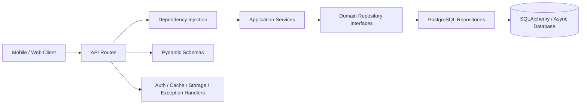

# Maths DD Backend

[](https://github.com/chamod-rashmith/maths_dd_backend/actions/workflows/tests.yml)
[](https://www.python.org/)
[](https://fastapi.tiangolo.com/)
[](https://cloud.google.com/sql)
[](https://www.docker.com/)

> Production-grade REST API for the Maths DD mobile and web ecosystem.

Maths DD is a FastAPI backend built with strict Clean Architecture, async database access, Firebase authentication, Google Cloud Storage, Redis caching, and automated tests through GitHub Actions.

## Highlights

- Clean separation between API, domain, service, repository, and infrastructure layers
- Versioned REST endpoints under `/api/v1`
- PostgreSQL support through Cloud SQL and SQLAlchemy
- Firebase Admin authentication and Google Cloud Storage integration
- Redis-backed caching with safe test-mode fallbacks
- Alembic migrations and Cloud Run deployment support
- Automated test status visible in the badge above

## Architecture



### Main directories

| Directory | Responsibility |
| --- | --- |
| [`app/api`](./app/api) | HTTP routes and dependency injection |
| [`app/domain`](./app/domain) | Domain contracts and business boundaries |
| [`app/services`](./app/services) | Application use cases |
| [`app/repositories`](./app/repositories) | Concrete data adapters |
| [`app/models`](./app/models) | SQLAlchemy models |
| [`app/schemas`](./app/schemas) | Request and response DTOs |
| [`app/core`](./app/core) | Configuration, database, security, cache, and storage |
| [`tests`](./tests) | Automated backend test suite |
| [`migrations`](./migrations) | Alembic migration scripts |

## Quick start

### 1. Configure environment

```bash
cp .env.example .env
```

Fill in the required PostgreSQL, Firebase, Google Cloud Storage, and Redis values in `.env`.

### 2. Install dependencies

Using `uv`:

```bash
uv sync --group dev
```

Using `pip`:

```bash
pip install -r requirements.txt
```

### 3. Run the API

```bash
uv run uvicorn app.main:app --reload --port 8080
```

Or:

```bash
python main.py
```

Once running, open:

- Swagger UI: <http://localhost:8080/docs>
- ReDoc: <http://localhost:8080/redoc>
- Health check: <http://localhost:8080/health>

## Testing

Run the complete test suite locally:

```bash
uv run pytest
```

GitHub Actions runs the same command for every push to `main` and every pull request targeting `main`.

## Database migrations

```bash
uv run alembic upgrade head
```

Create a new migration:

```bash
uv run alembic revision --autogenerate -m "describe migration"
```

## Docker

Build and run the production image:

```bash
docker build -t maths-dd-backend .
docker run --env-file .env -p 8080:8080 maths-dd-backend
```

The image uses a non-root application user and is configured for deployment to Google Cloud Run.

## CI status

The [GitHub Actions workflow](./.github/workflows/tests.yml) installs locked dependencies with `uv`, then runs all tests with Python 3.12. A green **Tests** badge means the latest `main` workflow completed successfully.

## License

This project is maintained for the Maths DD application.
